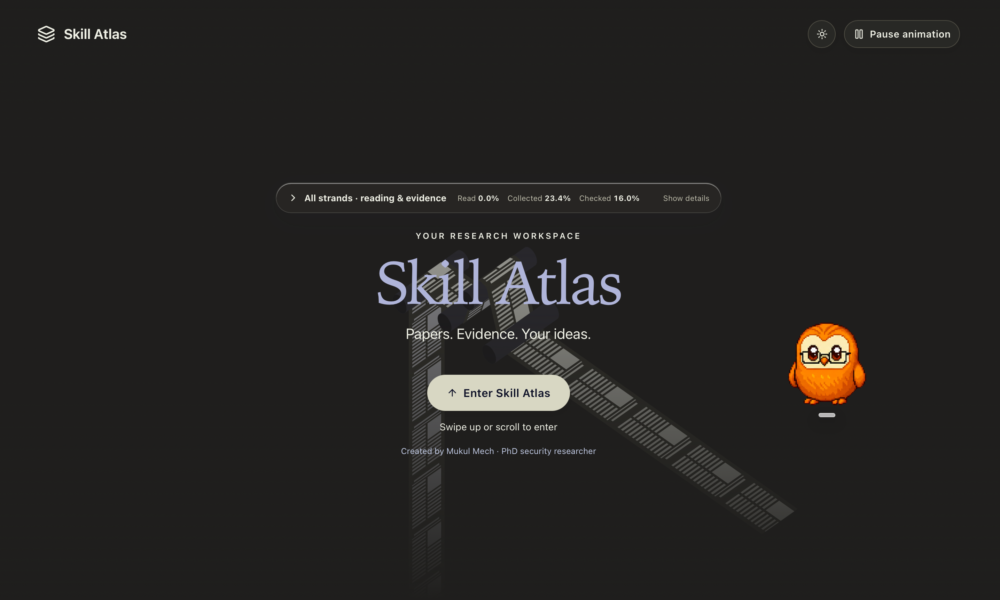
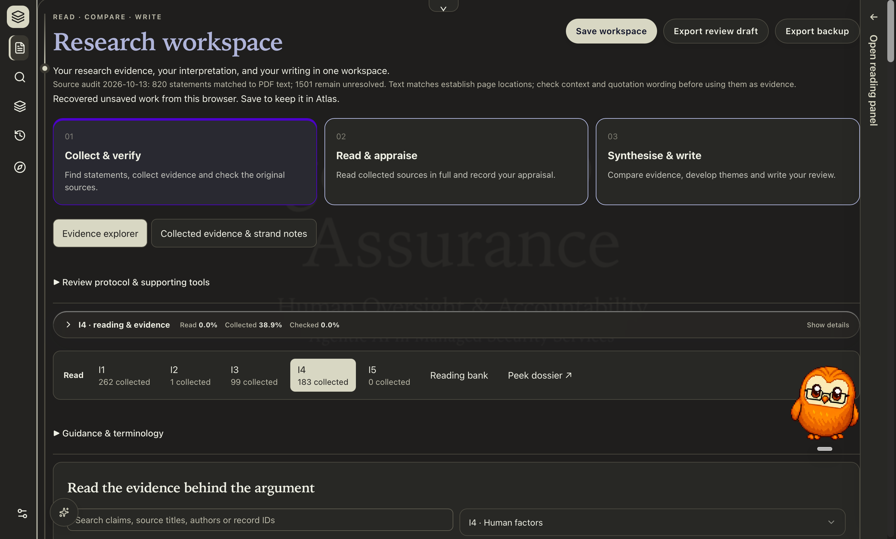
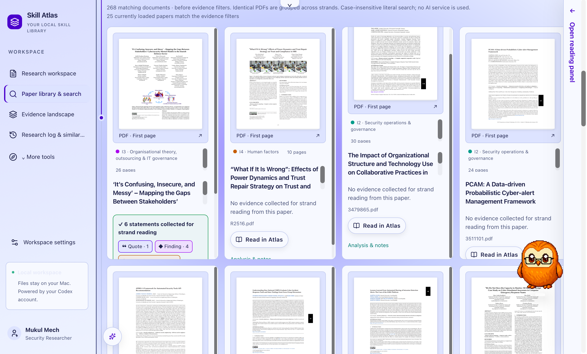
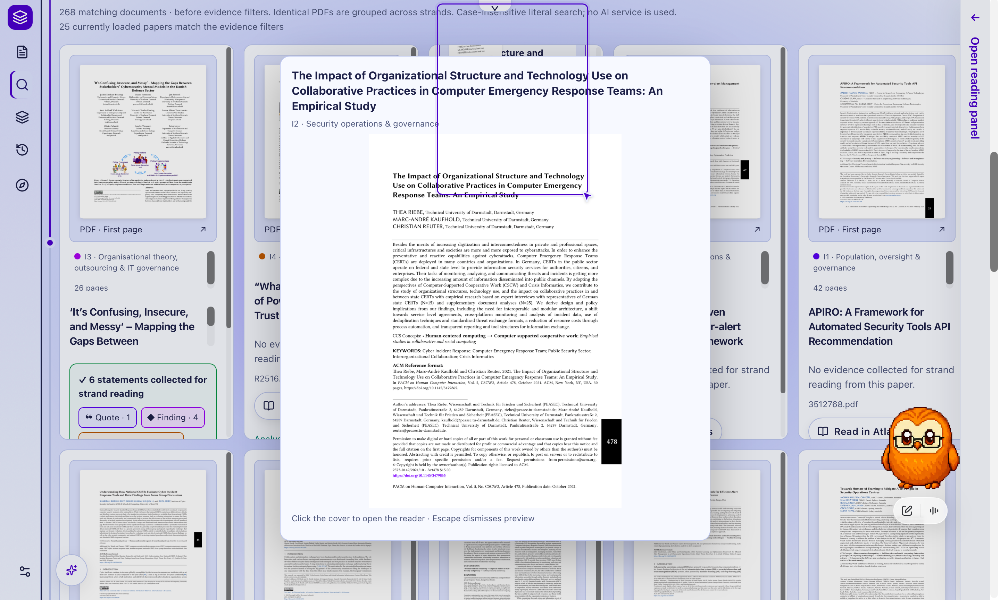
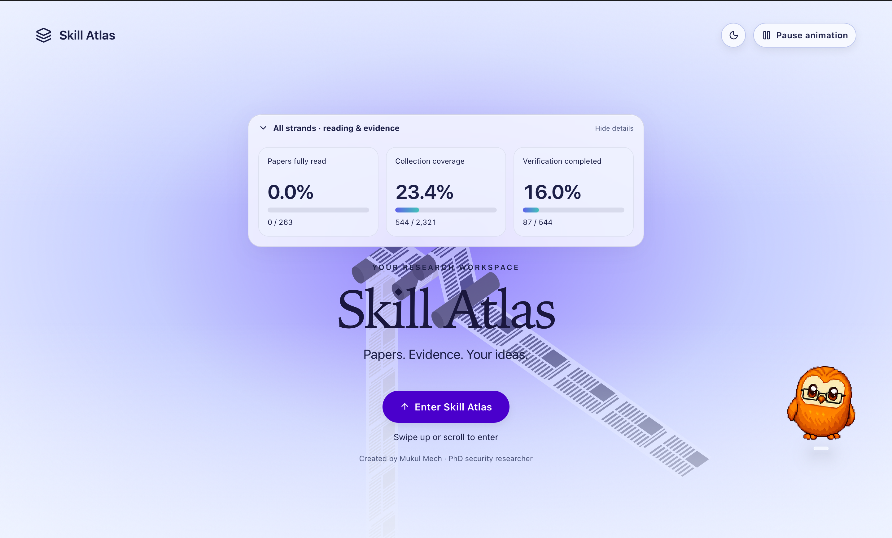

https://github.com/user-attachments/assets/a604f909-12dd-4b71-a3d9-fd2fdd0d6643

# Skill Atlas

**Your research desk—with your papers, notes and ideas within reach.**

Skill Atlas keeps your PDFs, useful passages, notes and writing together on your Mac. Give each project its own topic—up to **five separate topics**—and pick up where you left off. You can invite Codex as an optional reading helper; you check the sources and make the decisions. Open Atlas as a Mac application without opening ChatGPT, or use it in your browser.

## Your research desk, explained simply

Papers in one folder, notes in another, and that brilliant quote… somewhere? **Skill Atlas helps keep them connected.** Bring your papers, save useful passages, add your own thinking and develop your writing in the same topic.


**One question → your papers → useful passages → your judgement → your writing.** Codex can be an optional reading helper along the way; you remain in charge of checking the sources.

[Take the plain-English tour](docs/START-HERE.md) · [See a fresh installation](docs/START-HERE.md#what-does-a-fresh-installation-actually-look-like) · [Install and run](#start)

## What a fresh installation looks like

You start with a profile form and **your own empty topic**—not the research collection shown in the populated screenshots further down. Built-in workflows are included; papers, analyses and personal notes are yours to add. The owl in the older example gallery is a separate desktop companion, not part of Atlas.

| First launch | After setting up a topic |
| --- | --- |
|  |  |
| Add your name and first topic. | Add papers, describe your question and begin your notes. |

These are actual v1.0 captures from an isolated empty installation. The later screen uses fictional “Alex Researcher” details; no papers were imported and Codex stayed disconnected. Theme depends on the chosen appearance. [See all six fresh-install previews and the first-paper steps](docs/START-HERE.md).

**Collected ≠ fully read ≠ verified.** Saving a passage, finishing a paper and checking a claim are different achievements. AI completion does not replace your review.

## Version 1.0

**1.0.0 keeps the current Skill Atlas UI.** The three exploratory layouts are not included in this release. The screenshots below show the retained interface.

See the [changelog](CHANGELOG.md), [security policy](SECURITY.md) and [source security review](docs/security-review-2026-10-21.md). The review recorded **0 confirmed vulnerabilities and 7 conditional leads requiring validation** in the maintained project, including legacy paths omitted from this package. Runtime exploit testing and dependency/CVE scanning were not performed; this is not security certification, and no security fixes are claimed in this release.

## A look inside Skill Atlas

Explore the welcome screen, research workspace and paper library in light and dark themes.



| Research workspace | Paper library |
| --- | --- |
|  |  |
| Collect evidence, appraise sources and develop your review. | Keep papers, notes and evidence connected to their sources. |

<details>
<summary>See the paper preview and light welcome screen</summary>



Preview a paper before opening the reader.



Expand the progress widget to see reading, collection and verification separately.

</details>

These older supplied screenshots show an example populated workspace, not bundled sample research or the first-run state. Use the fresh-install tour above to see a new installation. The owl is a separate desktop companion overlay.

## What it does

| Research material | How Atlas helps |
| --- | --- |
| Papers and supporting files | Import PDF folders for reading and review; attach other research files to analysis tasks. Keep source copies alongside their project records. |
| Reading and searching | Search extracted PDF text, open physical source pages, use page buttons or continuous scrolling, and return to saved reading positions. |
| Understanding a paper | Optionally connect your authenticated Codex CLI to run source-grounded paper reading and appraisal workflows. Saved tasks can be continued later. |
| Evidence and highlights | Inspect exact text anchors, collect evidence, bookmark passages, and navigate category markers beside the PDF. Source-page references keep claims connected to their context. |
| Your own judgement | Record personal notes, screening choices, appraisal, themes and source-support checks separately from AI drafts. |
| Writing and continuity | Keep review questions, scope, writing sections and drafts in the same topic. Export drafts and backups; use task history to see how analysis developed. |

## Why it is useful

Research often gets split between PDF folders, notes, AI chats, spreadsheets and draft documents. Atlas gives those pieces a common place and a route back to the source. You can find a passage, inspect its context, record what you think it means, and carry it into your review without losing the paper and page behind it.

For example: create a topic → import papers → define the research question → analyse selected papers with Codex → check the original passages → keep your notes and screening decisions → compare evidence and write. You can pause and return to the same topic with its saved material and conversation history. Separate topics help keep unrelated projects from mixing.

## PDF reader and highlight markers

The reader groups page navigation, reading mode, zoom and tools into aligned controls. Reading progress and category filters have their own disclosure. On narrow readers, the inspector opens **below the PDF**, keeping the page visible; it has a dedicated close control.

Clickable coloured markers sit beside the page: **G** Goal, **M** Method, **R** Result, **L** Limitation, **C** Contribution and **E** Evidence. The number identifies a passage on that page. Select a marker to inspect the associated passage; hover or focus it for its label. Markers appear for located source text, not for every item in an AI analysis. A page reference without an exact text anchor remains unhighlighted. Highlights and markers can be switched off in the reader.

AI analysis is an aid to your review. An exact text match establishes a location, not that a claim is true or adequately supported. Author claims, AI interpretations and your decisions remain distinct. Page coverage, fully read confirmation, evidence collection and source verification are separate progress measures.

## Start

Requires Node.js 24+ and npm. Install dependencies, then launch:

```sh
npm ci --prefix dashboard
npm start
```

Open http://127.0.0.1:4310. Keep this process open. Stop with Control-C or `npm run stop` in another Terminal. The interface uses a local Vite server; this release is for local use, not public web hosting.

## Mac application

On macOS with Apple's command-line developer tools installed:

```sh
npm run app:mac
```

Open `output/Skill Atlas.app` from Finder, or double-click `Start Skill Atlas.command`. The app includes its own Node runtime, a native window, edit shortcuts, file dialogs, persistent browser storage and logs. The build copies the local runtime and its non-system dynamic libraries; use `ATLAS_NODE_RUNTIME` to select another Node 24+ executable. This is a locally signed app for the current Mac architecture; public binary distribution needs the developer's signing/notarisation and dependency-license review.

Quit from Skill Atlas → Quit Skill Atlas or Command-Q. Quit stops the workspace services and active analysis; saved conversations can be explicitly continued later. Closing the window keeps the application running, as on other Mac apps. Logs: `~/Library/Logs/Skill Atlas/atlas.log`. Rebuild after moving the source folder. `Stop Skill Atlas.command` also stops the services.

## Research workflow

1. Enter your name, role, optional institution and first research topic.
2. Import a local PDF folder in Paper review, supplying the research question for that collection. The task workbench also accepts supporting file attachments (up to 20 files / 30 MB per upload).
3. Install and authenticate the Codex CLI separately; set `CODEX_BIN` if it is not on your PATH. Click Connect in the app. A running ChatGPT application is unnecessary. AI processing uses your configured Codex account and sends task context to the configured AI service.
4. Analyse individual papers using the included source-grounded research workflows. Additional skill collections are optional imports.
5. Inspect original pages, appraisals, screening decisions and your notes. Continue saved tasks through Task history.
6. Save the review brief, editable writing outline and drafts; export your writing and workspace backup.

PDF extraction and source previews require Python 3 with the packages in `dashboard/requirements.txt`. Set `RESEARCH_PYTHON` and `RESEARCH_SEARCH_PYTHON` to the Python environment's executable. Scanned PDFs need separate OCR. Long documents require a scoped range of at most 100 PDF pages for analysis.

Researcher review, full reading, AI analysis and source verification are separate states. The app does not certify findings or automate acceptance decisions. The generic workspace supports arbitrary research questions and writing sections. Additional advanced legacy SLR tools remain in the code as an optional study-specific template; they are not prefilled research for a new user.

## Reading layout

Click the reading-and-evidence heading to expand or collapse its metrics. Each topic remembers the widget state. Compact controls are the default; select Comfortable in Workspace settings → Control size or in the reader’s More menu. Text size is unchanged. Reader navigation, resize and close actions stay in a short toolbar; More contains secondary actions. Touch devices retain larger control targets.

## Storage and checks

The first topic uses `dashboard/.local/` and `research/`. Additional topics use isolated directories under `dashboard/.local/topics/`. Back these up along with any externally registered project folders. Save work before switching topics. Browser recovery drafts are scoped per topic; saved data is authoritative, and stale saves are rejected.

```sh
npm run typecheck
npm run build
npm test
```

Tests include temporary research state and mock Codex; they do not run real AI jobs. Tests of optional upstream skill collections require those checkouts. The app is for one trusted local user. Topic separation is an organisational boundary, not access control between users of the same computer.

## GitHub and redistribution

Keep `.local`, `research`, `upstream`, credentials, generated outputs and `.env` files out of Git. `MANIFEST.json` records the exact packaged source files. Source packaging excludes research state, account files, PDFs, drafts, machine-specific mappings, downloaded skill repositories and compiled binaries.

Created by Mukul Mech. Existing third-party attribution is retained. No blanket open-source license has been assigned: choose a repository license after reviewing component provenance and dependency licenses. In particular, review any commercial design-component adaptations before public redistribution.
