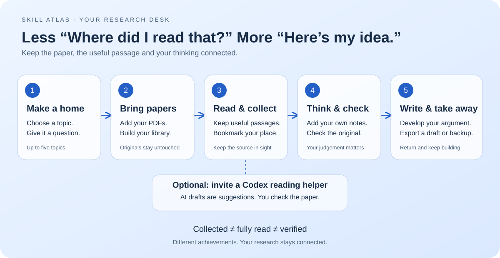
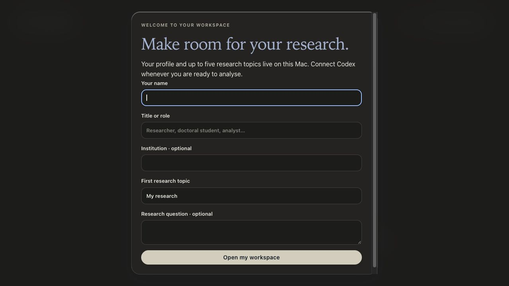
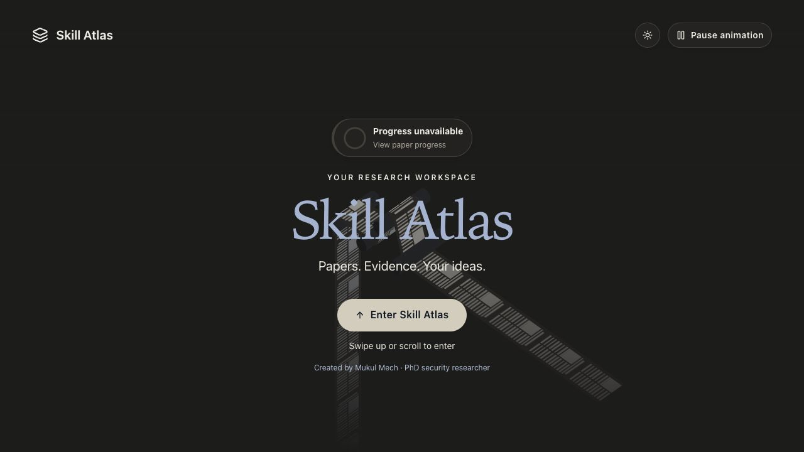
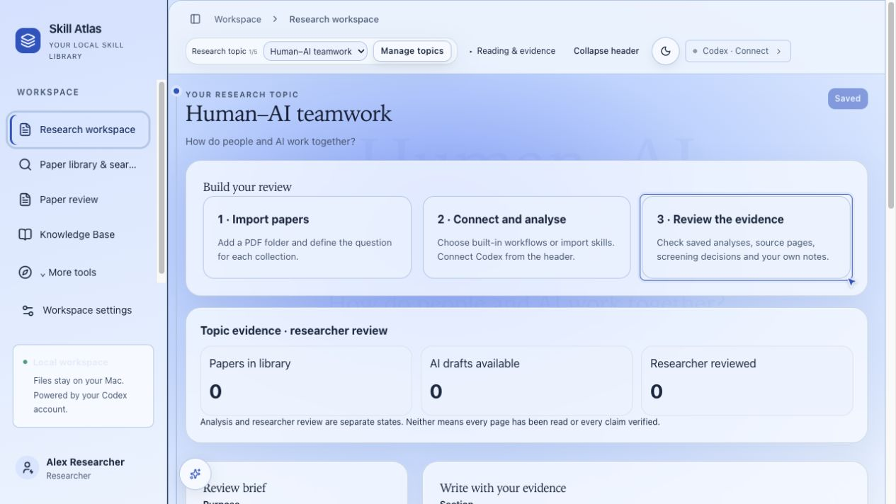
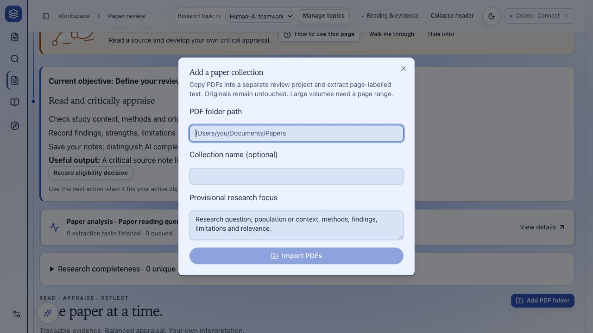
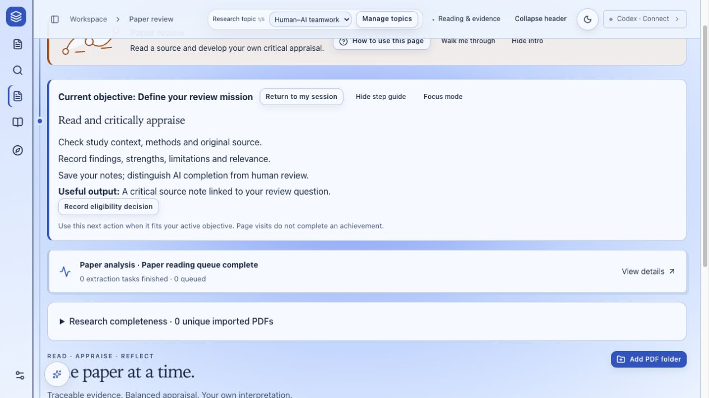
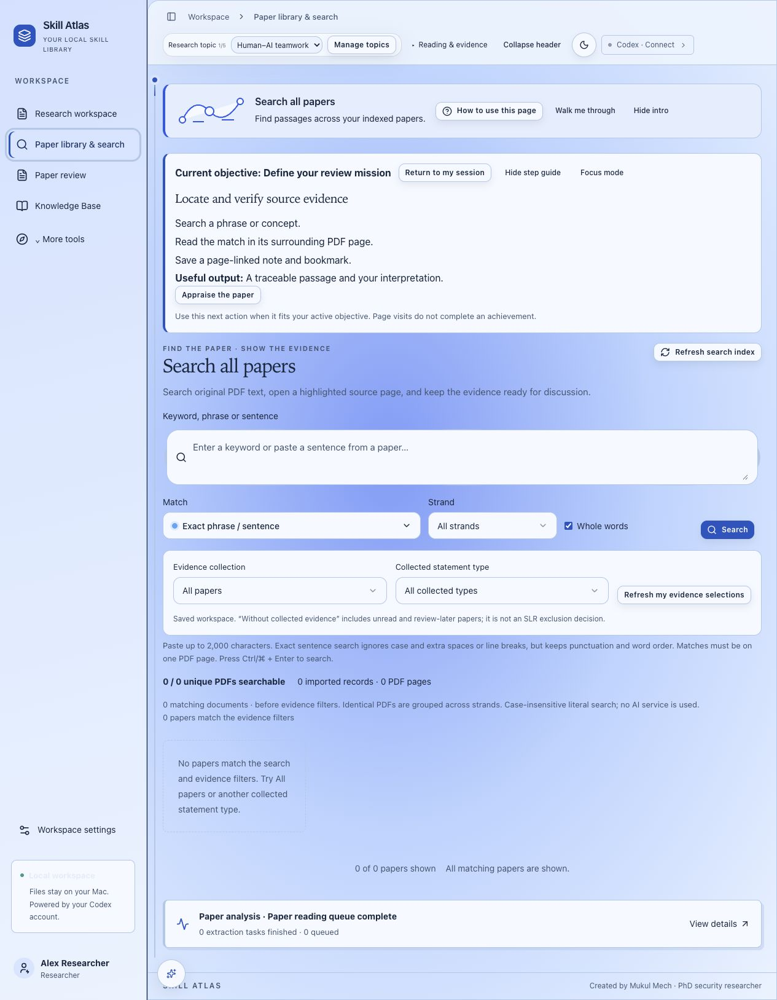

# Meet your research desk

**Skill Atlas keeps your papers, useful passages, notes and drafts together—so you spend less time wondering “Where did I read that?” and more time developing your ideas.**

Think of it as a research desk with labelled drawers, sticky tabs and a notebook. You bring the papers and curiosity. Atlas helps you keep the pieces connected.

## What does a fresh installation actually look like?

It starts with **your own empty workspace**, not the maintainer's research. The software includes built-in research instructions/workflows, but no sample paper collection, completed analyses or personal research notes. There is no owl companion bundled with Atlas.

The screenshots below were captured from a disposable copy of the **actual v1.0 application**, with separate empty state. They are not redesigns or artist's impressions. After the untouched onboarding screenshot, “Alex Researcher” and “Human–AI teamwork” were entered as fictional demonstration details. Zero PDFs were imported; no Codex connection or paid analysis was started. These are browser captures of the unchanged v1.0 frontend; the native wrapper uses the same interface. Existing locally installed dependencies were reused, so this is a fresh-state preview, not a newly validated network installation or signed-binary test. The captures show both themes; the initial theme can depend on the browser/system setting.

### 1. Say hello

Enter your name and first topic. “My research” is supplied as a starting topic name; you can replace it. Role, institution and research question can be filled in too. Open your workspace when ready.

### 2. Enter your research desk

After onboarding, the welcome screen leads into Atlas. On a clean installation the welcome progress chip may say **Progress unavailable**: there is no paper-analysis history yet. It is not a claim that any paper has been read or verified.

See the actual fresh welcome screen

### 3. Start with a question, not a mountain of tabs

Your first topic opens with a review brief, a writing area, and three next-step cards. The counters begin at **0 papers, 0 AI drafts and 0 researcher-reviewed papers**. Writing sections have starter headings, but no written review is supplied. Codex remains disconnected until you choose to connect it.

### 4. Bring your own papers

Choose **Import papers** or **Paper review → Add PDF folder**. Provide the folder containing your PDFs, optionally name the collection and describe your research focus. Atlas makes working copies; it does not alter the originals. No documents appear automatically just because the application was installed.

See the empty paper-review page and searchable library

## Your first research adventure

Let's imagine your question is **“How do people and AI work together?”**

| Step | Your move | What Atlas helps you keep |
| --- | --- | --- |
| **1 · Make a home** | Create a topic and write the question. | A separate place for that project. You can have up to five topics. |
| **2 · Bring papers** | Import a PDF folder. | Working copies, paper details and a place to return to each source. |
| **3 · Read & collect** | Read a paper and save useful passages or bookmarks. | The passage and its source-page connection—digital sticky tabs. Exact highlight markers appear only when source text is located. |
| **4 · Think & check** | Add your interpretation and check important claims against the original. | What the paper says, what AI suggests and what you think as distinct things. |
| **5 · Write & take away** | Compare evidence, develop your argument and export. | Your draft and a backup you can keep outside Atlas. |

You can loop back to reading whenever writing raises another question. This is a working desk, not a conveyor belt.

## Want a reading helper?

**Codex is optional.** You can organise papers, read, take notes and write without AI analysis. If you choose to connect your own Codex account, it can help prepare summaries and appraisals of selected papers. Saved task history helps you pick up the conversation later.

The helper makes suggestions; **you remain the researcher**. Check important quotations, numbers and interpretations in the original. AI completion does not mark a paper as fully read, checked or approved by you.

Your workspace files are stored on your Mac. When you deliberately run AI analysis, the selected task context/files may be sent to the configured AI service. Local storage does not mean chosen AI tasks are offline. Your account's service terms and usage limits apply.

## Three different achievements

| Label | Plain-English meaning | What it does not mean |
| --- | --- | --- |
| **Collected** | “I saved something useful.” | “I read the whole paper.” |
| **Fully read** | “I finished the paper and recorded that.” | “Every claim is true.” |
| **Checked / verified** | “I checked the relevant evidence against its source.” | “AI generated a summary, so it must be correct.” |

A paper with no exact text anchor may have a page reference without a coloured highlight. That is an honest missing location, not a reason to invent a marker.

## What is included—and what you bring

| Included in the skeleton | You add |
| --- | --- |
| The v1.0 interface, built-in research workflows and setup scripts. | Your profile, research questions and PDF folders. |
| Reading, search, notes, evidence, drafting and export tools. | Your interpretation, source checks and screening decisions. |
| An optional Codex connection. | Your own configured Codex account if you want AI analysis. |

This is a source/skeleton distribution: follow the [installation instructions](../README.md#start) before the first-run screens appear. It is not a signed one-click installer, and the release does not bundle a new signed/notarised Mac binary. See [validation notes](../VALIDATION.md) and the [security policy](../SECURITY.md) for the practical limits.

## A thirty-second explanation you can use

> “Skill Atlas is my research desk. I add papers, keep the useful passages beside my notes, and build my writing without losing where an idea came from. I can invite an AI helper, but I still check the sources and make the decisions. Each project gets its own space, so I can put it down and pick it up again.”
